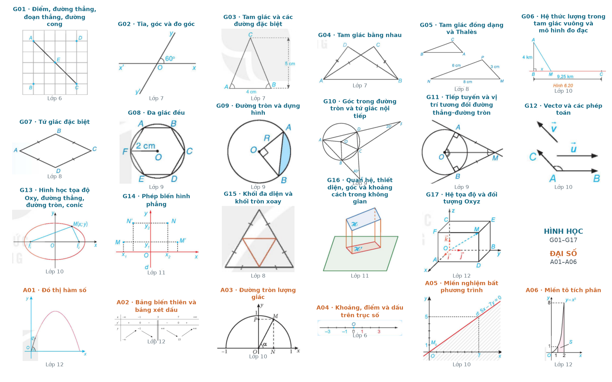
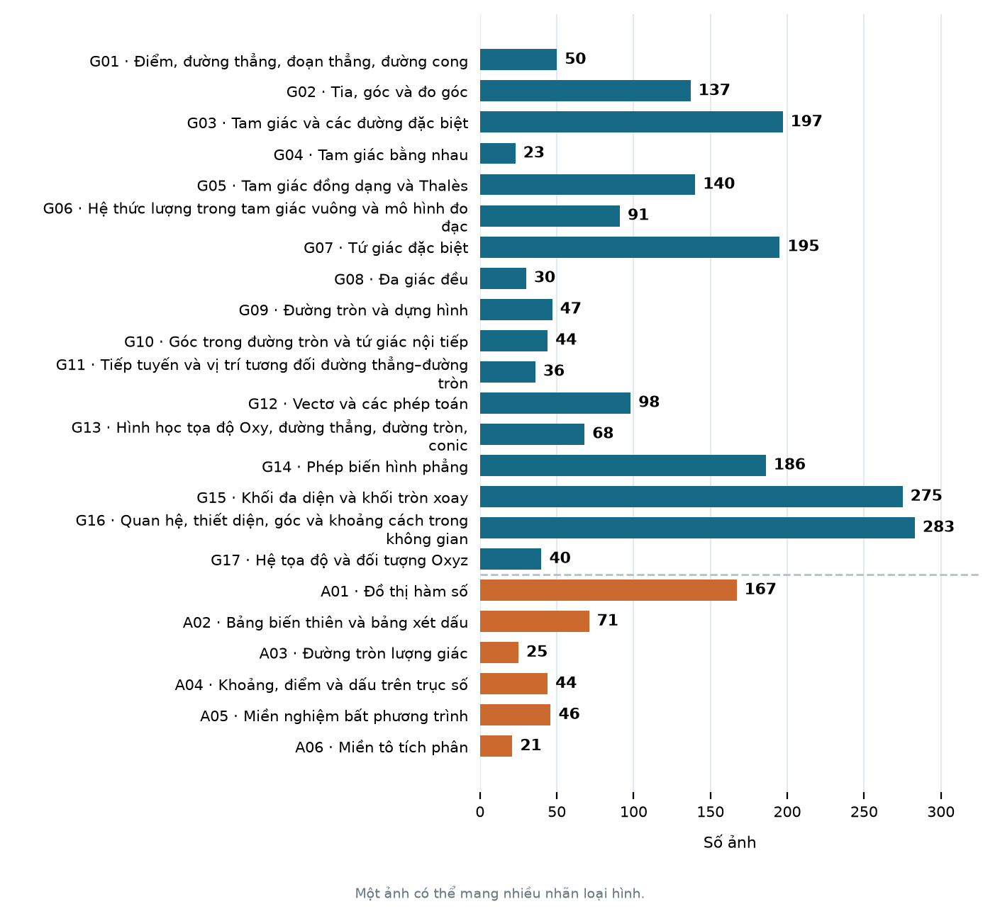

# K-12 Mathematical Diagrams with TikZ: Generate, Edit & Reconstruct

## 1. Problem statement

Bài toán là chuyển nội dung toán học và hình vẽ trong tài liệu phổ thông thành **TikZ có thể chỉnh sửa và tái sử dụng**. TikZ đầu ra cần biểu diễn đúng đối tượng, quan hệ toán học, nhãn và quy ước trình bày.

```text
Đề bài / yêu cầu vẽ ── Generate → TikZ
Ảnh ─────────────── Reconstruct → TikZ
                                    ↓
                            TikZ + yêu cầu sửa ── Edit → TikZ mới
```

## 2. Why TikZ?

TikZ phù hợp vì nó vừa là output để render, vừa là một structured representation của diagram:

- biểu diễn hình bằng các primitive và command có cấu trúc
- compile thành vector graphic
- source code có thể inspect, edit và version

**AutomaTikZ** đã chứng minh `text → TikZ` là một formulation khả thi cho scientific figure generation, với dataset DaTikZ gồm khoảng 120k cặp caption–TikZ và fine-tuning language model để sinh TikZ trực tiếp [1].

**GeoTikzBridge** cho thấy việc sử dụng geometric structures thông qua TikZ code có thể cải thiện geometric perception và downstream reasoning của models phục vụ việc giải toán hình [2].

## 3. Related work

### Approach A: Text → TikZ

```
Text → Model → TikZ → Diagram
```

Model học trực tiếp mapping giữa mô tả hình học và TikZ code.

Các research tiêu biểu:

- **AutomaTikZ**: fine-tune language model trên caption–TikZ pairs [1].
- **TikZilla**: mở rộng Text-to-TikZ bằng dataset lớn hơn, sau đó train theo hai giai đoạn SFT → Reinforcement Learning, trong đó reward có sử dụng thông tin từ rendered image [3].

Pipeline đơn giản nhưng khó khăn cho model phải học cùng lúc semantic geometry, spatial layout, coordinate placement và TikZ syntax.

### Approach B: Text → Geometry IR → Solver → Diagram

Thay vì sinh drawing code trực tiếp, model dựa theo quy ước về một representation hình học có cấu trúc.

```
Text → Model → Geometry IR → Constraint / Coordinate Solver → TikZ
```

Geometry IR có thể mô tả các primitives và constraints như:

```
Triangle(A, B, C)
Midpoint(M, B, C)
Perpendicular(AH, BC)
Parallel(MN, BC)
```

Ý tưởng chính là tách hai vấn đề:

```
Language understanding / geometric semantics → Geometry IR → Coordinate & layout realization
```

**MagicGeo** formalize textual geometry thành một formal representation rồi dùng coordinate solver để bảo đảm các quan hệ hình học trước khi render [4].

Một ví dụ gần đây rõ hơn là **GeoLoom**, với pipeline:

```
Text → GeoLingua → Coordinate Solver → Diagram
```

GeoLingua đóng vai trò Geometry IR, mô tả shape, constructive dependence và các length/angle constraints. GeoLoom đồng thời xây dựng GeoNF, một dataset ghép natural-language descriptions với formal representations [5].

### Concept C: Geometry IR cho verification

Geometry IR không nhất thiết phải nằm trong generation path.

Một pipeline khác là:

```
Text → Model → TikZ → Geometry IR → Structural validation
```

**DiagramIR** sử dụng intermediate representation của TikZ để đánh giá geometric diagrams bằng các rule-based checks, thay vì chỉ dựa vào image similarity hoặc LLM-as-a-Judge [6].

## 4. Dataset

Nguồn chuẩn bị dataset là **ảnh diagram lớp 6–12** và **ví dụ, luyện tập, bài tập lớp 6–9** trong corpus SGK/SGV đã xử lý. Danh sách tuyển lưu ảnh cụ thể và nguyên văn từng bài, có thông tin phân loại và nguồn đối chiếu [8, 9].

### Quy mô nguồn đã tuyển

| Lớp | Ảnh diagram | Ví dụ | Luyện tập | Bài tập |
| --- | ---: | ---: | ---: | ---: |
| 6 | 307 | 13 | 18 | 102 |
| 7 | 301 | 49 | 33 | 150 |
| 8 | 343 | 43 | 32 | 143 |
| 9 | 289 | 60 | 33 | 175 |
| 10 | 237 | — | — | — |
| 11 | 442 | — | — | — |
| 12 | 285 | — | — | — |
| **Tổng** | **2.204** | **165** | **116** | **570** |

Tập ảnh gồm **23 loại hình: 17 loại Hình học (G01–G17) và 6 loại Đại số (A01–A06)**. **851 đơn vị nội dung** được tính theo từng ví dụ/luyện tập/bài tập hoàn chỉnh, gồm các tiểu ý đi kèm. Đây là nguồn đã tuyển để xây dựng các cặp có `target_tikz` [9].





### Cấu trúc mẫu

| Task | Input | Target |
| --- | --- | --- |
| **Generate** | `instruction`: đề bài hoặc yêu cầu vẽ từ ví dụ/luyện tập/bài tập | `target_tikz` |
| **Edit** | `current_tikz` + `instruction` | `target_tikz` |
| **Reconstruct** | `image` + `instruction` | `target_tikz` |

TikZ đã có từ Generate hoặc Reconstruct có thể tiếp tục làm input cho Edit.

### Thuộc tính phân loại

| Thuộc tính | Nội dung |
| --- | --- |
| `task` | Generate, Edit hoặc Reconstruct |
| `grade` | Lớp của nội dung nguồn |
| `diagram_types` | Một hoặc nhiều mã loại hình trong taxonomy Hình học hoặc Đại số |
| `source_kind` | Ví dụ, luyện tập hoặc bài tập, khi mẫu có nguồn bài tương ứng |
| `book_role` | SGK, SGV hoặc sách chuyên đề |
| `source_id` | Liên kết đến hình/bài nguồn, dùng nhóm các mẫu cùng nguồn |

### Mở rộng dữ liệu

- geometry-specific samples từ các TikZ dataset công khai như: [GeoTikz-Base](https://huggingface.co/datasets/SJY-1995/GeoTikz-Base)(2.45M image-to-TikZ, phục vụ Recontruct), [GeoTikz-Instruct](https://huggingface.co/datasets/SJY-1995/GeoTikz-Instruct)(421K instruction-based image-to-TikZ, phục vụ Edit), [DaEdiTikZ](https://huggingface.co/datasets/nllg/DaEdiTikZ)(106k realistic scientific-figure editing trajectories for TikZ, phục vụ Edit). Tuy nhiên việc các dataset tập trung nhiều vào scientific figures hơn là mathematical diagrams nên cần phải lọc kĩ dữ liệu trước hoặc dành cho bước cải thiện đọc cấu trúc hình và viết TikZ cho baseline model thay vì tập trung vào 3 tasks chính mình đang kì vọng.
- synthetic examples sinh từ predefined geometric constraints: Từ TikZ code có được ở task Recontruct để phục vụ sinh ra các yêu cầu cho Generate và Edit

## 5. Evaluation

Cả ba task đều được đánh giá trên `output_tikz` bằng cách so sánh với `target_tikz`, theo cùng các tiêu chí:

| Tiêu chí chung | Nội dung đánh giá | Phạm vi và căn cứ kiểm tra |
| --- | --- | --- |
| **Compile rate** | TikZ biên dịch thành công |  |
| **Mathematical correctness** | Tọa độ, số đo, quan hệ hình học, miền, nhánh, dấu và chiều biến thiên | Kiểm tra các thành phần đã có thỏa điều kiện toán học tương ứng trong instruction/target và nhất quán với ký hiệu trên hình. Ví dụ, đường cao đã vẽ nhưng không vuông góc với đáy là lỗi correctness. |
| **Content coverage** | Chọn và biểu diễn đủ thông tin cần truyền đạt, tránh thiếu dữ kiện hoặc thêm nội dung ngoài phạm vi | Từ tập dữ kiện ứng viên, xác định phần cần truyền đạt theo instruction/target và kiểm tra phần đó đã có trong hình hay chưa. Ví dụ, thiếu đường cao được yêu cầu là lỗi coverage. Một dữ kiện có thể được truyền đạt qua cấu hình, nét, nhãn hoặc dấu. Số dữ kiện cần thể hiện không đồng nhất với số ký hiệu phải vẽ. |
| **Visual readability** | Bố cục, tỉ lệ và khả năng phân biệt các thành phần | Các thành phần đã chọn có rõ, dễ đọc, dễ liên hệ với đúng đối tượng và tránh chồng lấn hay không. Yêu cầu cụ thể về bố cục hoặc vị trí được đối chiếu thêm với instruction/target. |

## References

[1] Belouadi, J., Lauscher, A., & Eger, S. **AutomaTikZ: Text-Guided Synthesis of Scientific Vector Graphics with TikZ.** ICLR 2024.

[https://arxiv.org/abs/2310.00367](https://arxiv.org/abs/2310.00367)

[2] Sun, J. et al. **GeoTikzBridge: Advancing Multimodal Code Generation for Geometric Perception and Reasoning.** 2026.

[https://arxiv.org/abs/2603.22687](https://arxiv.org/abs/2603.22687)

[3] Greisinger, C., & Eger, S. **TikZilla: Scaling Text-to-TikZ with High-Quality Data and Reinforcement Learning.** ICLR 2026.

[https://arxiv.org/abs/2603.03072](https://arxiv.org/abs/2603.03072)

[4] Wang, J. et al. **MagicGeo: Training-Free Text-Guided Geometric Diagram Generation.** 2025.

[https://arxiv.org/abs/2502.13855](https://arxiv.org/abs/2502.13855)

[5] Wei, X. et al. **GeoLoom: High-quality Geometric Diagram Generation from Textual Input.** 2025.

[https://arxiv.org/abs/2512.08180](https://arxiv.org/abs/2512.08180)

[6] Kumar, V. et al. **DiagramIR: An Automatic Pipeline for Educational Math Diagram Evaluation.** 2025.

[https://arxiv.org/abs/2511.08283](https://arxiv.org/abs/2511.08283)
