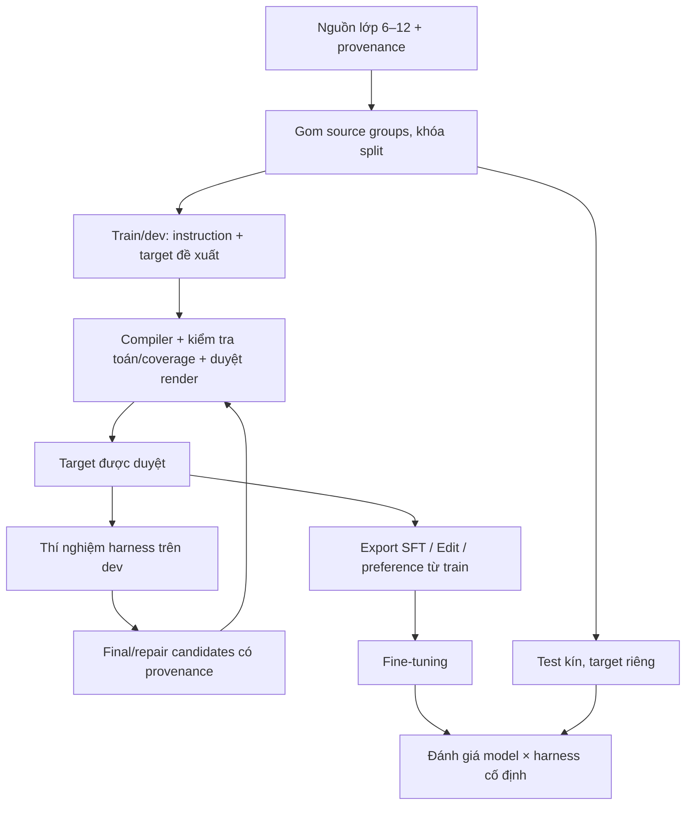

# TikZ research protocol: harness và dữ liệu fine-tuning

Ngày chốt research: **2026-09-28**. Trạng thái: **thiết kế thí nghiệm, chưa chạy các thí nghiệm E0–E9 bên dưới**. Các quan sát pilot trước đây được dẫn riêng, không dùng như kết quả của protocol này.

Đọc cùng [task contract](K-12%20Mathematical%20Diagrams%20with%20TikZ.md), [working plan](tikz-improvement-plan.md), [related works](tikz-related-work.md) và [sổ nguồn paper](papers/README.md).

## 1. Câu hỏi và phạm vi

**RQ1 — harness (confirmatory):** câu hỏi incremental utility và thiết kế paired được định nghĩa ở §1.1; input, candidate ban đầu, model sửa, metric, MCID và quyết định âm/dương đều được khóa trước test.

**RQ2 — dữ liệu/model:** trên source groups và fault families chưa thấy, SFT từ final targets cộng repair pairs đã duyệt có tăng strict-task pass trong one-shot evaluation so với final-only SFT được replay cùng token budget không (E6, arm B−C)? E9 sau đó kiểm tra riêng tương tác model × harness.

Có hai đầu ra cùng quan trọng:

1. **Harness:** giảm nhận nhầm hình sai, giảm sửa hỏng hình đúng, giảm chi phí để có một hình đạt yêu cầu.
2. **Dataset/model:** target có provenance, các cặp Edit/repair có phần cần giữ được xác nhận, split theo nguồn và bằng chứng fine-tuning giúp ích ngoài tập đã dùng điều chỉnh harness.

Chỉ làm nội dung lớp 6–12. Nguồn nội dung vẫn là corpus local; paper cung cấp phương pháp và đối chứng. Generate hiện có nguồn bài hoàn chỉnh lớp 6–9; không tự tạo provenance Generate lớp 10–12 từ ảnh. Reconstruct dùng crop lớp 6–12. Không thay generation path bằng Geometry IR/solver, không xây thêm drawing loop hoặc provider framework.

### Canon: điều đã biết và điều chưa được phép kết luận

| Căn cứ | Trạng thái | Hệ quả cho protocol |
| --- | --- | --- |
| Validator ngày 2026-09-28: 2.204 ảnh selected, 851 bài prepared; riêng 285 ảnh và 34 bài needs_review | Đã kiểm tra trong lượt research này | Đây là source-readiness, không phải số training pairs |
| Ba manifest pilot/phase-1 có 8 target drafts trong 6 source groups; cả 8 còn needs_review | Đọc trực tiếp manifest | Chưa có tập approved trong batch này; không dùng làm held-out benchmark |
| Working plan lưu 5 controlled faults mà DiagramIR không phát hiện; đồng thời check closure có hoạt động | Quan sát lịch sử của repo, không chạy lại trong lượt này | Cần kiểm định phạm vi từng check; không suy ra false-negative rate của toàn bộ paper |
| AutomaTikZ/TikZero cho thấy metric ảnh có thể bị ảnh hưởng bởi chữ trong hình; MagicGeo/GeoLoom tách quan hệ hình học khỏi render | Evidence-backed trong phạm vi nghiên cứu gốc | Compile/ảnh đẹp/IR hợp lệ chưa đủ để duyệt target |
| Dữ liệu Edit/reconstruction và feedback từ execution là các hướng có bằng chứng liên quan | Evidence-backed ở tác vụ/bộ dữ liệu khác | Chuyển sang SGK Việt Nam và harness này vẫn là giả thuyết |
| Cải thiện học tập của học sinh; phương pháp mới đầu tiên; model nào tốt nhất cho toàn bộ taxonomy | Chưa có bằng chứng | Không tuyên bố từ pilot, VQA hoặc preference của người duyệt |

**Luận điểm cần kiểm chứng:** chất lượng instruction và độ tin cậy của feedback có thể là nút thắt trước kích thước model. Giải thích thay thế phải loại trừ: tăng số call; nhận thêm thông tin oracle; học thuộc họ hình; chỉ chọn các ca compile; evaluator ưu ái teacher hoặc phong cách code.

**Section contract của tài liệu:** E0–E4 phải trả lời về measurement/harness; E5–E8 về dữ liệu/training; E9 tách tác động model và harness. Mọi số ngân sách ở phần sau là trần **đề xuất**, không phải số mẫu đã tạo hay kết quả đo. Viết hypothesis riêng với observation; không dùng điểm judge làm chứng cứ toán học.

### Evaluation hiện tại đang kết luận điều gì?

Deterministic phần hiện có là tool validation/render/compile, standalone wrapper và label placement. Chúng bảo đảm TikZ chạy được và render được; không tự kiểm độ dài cạnh, góc, order/label theo task hay invariant Edit. Verifier DiagramIR hiện là CLI offline nhận IR đã tạo; chưa có tự động trích IR và chưa tạo requirement predicates. Ba đầu ra run hiện tại vì thế cần giữ riêng:

- workflow_accepted: TikzResult.success trong ../mathmath/src/agent/workflows/tikz.py. Sau khi compile/render, chính model dùng để vẽ tạo TikzReview; nếu issues rỗng thì middleware kết thúc và ghi accepted. Đây là self-review status, chưa đối chiếu nguồn hay target.
- compile_success: compile theo wrapper thành công. Chỉ kiểm tra TikZ chạy được.
- evaluation_pass: runner dùng model grader khác worker để chấm một ProblemCandidate và rubric đã duyệt. Nó độc lập model với author, nhưng kết quả vẫn là phán xét LLM; fixture chưa so output với target_tikz như task contract. Đây là diagnostic, chưa là gold outcome.

Không báo workflow_accepted hoặc evaluation_pass như “diagram correctness”. Nếu mọi run đều accepted, có thể reviewer/rubric thiếu khả năng phân biệt các lỗi mục tiêu. Không đổi ngưỡng sau khi thấy kết quả để tạo thêm pass.

**Evidence local về độ phân biệt còn thiếu:** trong [controlled probes](tikz-improvement-plan.md#controlled-faults-where-the-papers-scope-stops), năm lỗi đã biết — tam giác không đều, cạnh vuông lệch độ dài, xóa trung tuyến, xóa đường chéo, đổi thứ tự nhãn — vẫn nhận upstream score 1.0 khi IR được cập nhật cho khớp hình sai. Đây là phép thử IR/checker offline, không phải ước lượng tỉ lệ lỗi tổng thể; nhưng nó chứng minh score ấy chưa kiểm tra các yêu cầu nguồn đó. Wrapper đã đúng khi chỉ gọi kết quả này evidence_only, không acceptance.

## 1.1. Bài toán đánh giá chính: checker có tạo giá trị ngoài model không?

**RQ1 confirmatory:** với cùng task input, cùng TikZ ban đầu y0, cùng model sửa và đúng một lượt sửa, báo cáo quan sát từ deterministic requirement checker có tăng strict-task pass so với cùng model được cấp chính requirement ledger nhưng không được cấp kết quả kiểm tra, đồng thời không làm hỏng hình ban đầu đúng? Đây là contrast V−R, nhằm tách giá trị của kết quả kiểm tra khỏi lợi ích chỉ do viết requirements tường minh. V−S (toàn bộ gói checker so với self-review) và R−S (requirements tường minh so với input tự nhiên) là contrasts phụ.

Đây là câu hỏi về incremental utility của checker. Mục tiêu không phải chứng minh “agent loop chấp nhận hình”, cũng không phải chứng minh mọi TikZ lớp 6–12 có thể kiểm tự động.

### Đơn vị và input

Một case là một task input đã khóa, một TikZ ban đầu y0 và render của nó, cùng một ledger tiêu chí nguồn. Primary repair cohort chỉ gồm cases có y0 là TikZ candidate biên dịch và render thành công; eligibility được quyết định và khóa trước khi chia arm. Đây là estimand về sửa diagram đã render được, không phải end-to-end generation reliability. Không có output, compile fail hoặc render fail vẫn được giữ trong denominator của full-pipeline outcome và báo riêng; không xóa các lỗi ấy khỏi báo cáo hệ thống. Đơn vị thống kê là source_group; crop, paraphrase, fault mutant và Edit derivative cùng nhóm không được coi là independent samples.

Ledger do hai người có chuyên môn toán lập và thống nhất **chỉ từ thông tin hợp lệ ở input boundary**:

- Generate: đề bài hoàn chỉnh và yêu cầu vẽ.
- Reconstruct: crop nguồn, không xem target.
- Edit: current_tikz + yêu cầu sửa; tách requested_changes và must_preserve.

Mỗi predicate ghi id, loại (object/relation/order/measurement/visible fact/edit invariant), đối tượng liên quan, giá trị/tolerance nếu có, mức critical, phạm vi thể hiện (must-show/optional), evidence span hoặc image region, và trạng thái supported/unsupported. Không lấy predicate từ target rồi giả là facts của input. Hai annotators xử lý bất đồng trước khi model chạy. Ledger là chuẩn đo bí mật của evaluator; worker tiếp tục nhận task input theo contract.

### Ba arm paired

Tạo và freeze cùng y0 một lần rồi clone vào ba arm:

| Arm | Author/repair thấy | Can thiệp duy nhất |
| --- | --- | --- |
| S — self-review | task input, y0, render; một lời gọi model yêu cầu phát hiện lỗi và trả TikZ đã sửa | Không có requirement ledger hay báo cáo executable checks |
| R — requirements-only | cùng task input, y0, render; cùng model và repair prompt | Thêm locked input-derived ledger với requirements/predicates; không cho biết observed value, trạng thái hay bằng chứng checker |
| V — verified feedback | cùng task input, y0, render; cùng model và repair prompt | Cùng ledger như R, cộng findings của checker: predicate, pass/fail/unknown, giá trị quan sát được và bằng chứng |

Giữ cùng checkpoint, repair prompt/template ngoài treatment field, decoding, một author call, max output tokens và compiler. R/V nhận cùng requirement text; khác biệt kiểm nghiệm là observed result/evidence. Ghi actual input tokens/latency: report trong V có chi phí thật. Vì thế đây là call-matched incremental quality effect, không phải equal-token hoặc equal-cost effect. y0 được chia sẻ nên khác biệt cuối không lẫn với hai lần generation ngẫu nhiên. LLM extractor nếu cần không được tính là deterministic checker: gate E1 phải chứng minh phép trích trước, khóa/cached extraction như nhau cho R/V và hạch toán call/cost; nếu chưa đạt thì chỉ báo checker-oracle diagnostic, chưa kết luận giá trị end-to-end.

Điều kiện V không được đọc target TikZ, target render, target diff, hidden score hoặc output của grader. Checker chỉ so requirements từ input với output được trích. Output ngoài miền hỗ trợ phải trả unknown; không map unknown thành pass.

### Gold outcome và estimand

Hai người chấm độc lập, blind với arm/model, đánh giá task input, ledger đã khóa, shared y0 và mọi final TikZ/render bằng cùng một rubric; artifact được xáo thứ tự và ẩn arm. Mỗi rater chấm y0 một lần và từng final để tạo A0/A1 theo cùng điều kiện. Họ ghi predicate-level evidence; metric tất định chấm compile và các quan hệ có thể tính chính xác; bất đồng được adjudicate trước khi mở test và lưu raw ratings. Rubric grader LLM chỉ là một cột so sánh với labels này.

Một artifact là **strict task pass** khi thỏa đồng thời:

1. compile thành công;
2. mọi predicate toán học critical đúng theo tolerance đã khóa;
3. đủ mọi information item must-show, không có assertion ngoài nguồn;
4. với Edit, mọi thay đổi yêu cầu có mặt và mọi invariant must_preserve còn đúng;
5. hai blind raters độc lập đều đạt readability ≥3 trên thang 1–4 đã khóa: 1 = không đọc/quan hệ gây hiểu sai; 2 = object/label cần có bị che, cắt hoặc gắn nhầm; 3 = mọi nội dung bắt buộc đọc được, chỉ còn lỗi trình bày nhỏ không gây hiểu nhầm; 4 = rõ và dễ phân biệt. Raters chấm crop, collision, label association và visual distortion; rubric không đổi sau dev.

Strict pass là nhãn gold của artifact, không phải trạng thái checker: checker trả unknown/abstain không tự biến hình đúng thành sai; nó làm giảm coverage và trong arm V nghĩa là feedback không có cho predicate đó. Gold label thiếu hoặc bất đồng chưa adjudicate là unscorable, không tự gán pass/fail; hoàn tất adjudication trước khi mở test, nếu còn thiếu thì báo tỷ lệ unscorable và giữ nguyên số đó trong coverage accounting. Báo riêng functional verifier coverage (tỉ lệ cases/predicates được checker hỗ trợ), correctness trên supported predicates, abstention, false accept và false reject.

Với mỗi case, đặt A0=1 nếu y0 pass, A1_a=1 nếu final của arm a pass; nếu không pass thì 0. Trong task t, net repair utility là U_{a,t}=mean(A1_a−A0). Damage_a = P(A1_a=0 | A0=1); rescue_a = P(A1_a=1 | A0=0). Báo các tỷ lệ này riêng, không chỉ net.

**Primary estimand** là paired Δ_VR = (1/3) Σ_t (U_{V,t}−U_{R,t}) = (1/3) Σ_t mean(A1_V−A1_R), với Generate, Reconstruct và Edit có trọng số ngang nhau. Tính CI bằng resampling source_group, giữ nguyên strata/task; báo Δ_VS và Δ_RS như contrasts phụ. Báo thêm final strict-pass, compile, từng predicate family, readability, checker false-accept và unknown. Không gộp chúng thành một model-judge score.

Đặt trước minimum practically important difference (MCID) = +10 percentage points cho Δ_VR và biên tăng damage (Damage_V−Damage_R) tối đa +5 pp, như lựa chọn quyết định của nghiên cứu, không phải số paper đã chứng minh. Chỉ kết luận checker report có utility đáng kể nếu estimate ≥ MCID, 95% CI không bao gồm 0 và upper CI của chênh lệch damage dưới biên đã khóa. Nếu CI rộng hoặc chưa đủ power, kết luận “chưa phân biệt được”, không “các arm đều pass”.

### Tập thử thách và lấy mẫu

Giữ ba stratum riêng:

1. **Natural outputs:** outputs của checkpoint/prompt/run configuration đã đóng trên examples từ held-out source groups. Không lọc chỉ case compile hoặc case reviewer báo lỗi. Giữ first output y0, kể cả lỗi tool/compile; output không tạo được TikZ vẫn là failure mode riêng.
2. **Controlled violations:** từ target/render đã được duyệt, tạo mutants có đúng một lỗi biết trước: thay tọa độ làm hỏng quan hệ/độ dài; bỏ đường/đối tượng được yêu cầu; sửa Edit sai hoặc làm mất phần giữ nguyên; đổi nhãn/thứ tự khi nguồn cố định thứ tự. Mỗi mutant gắn parent group; dùng phát triển/calibration riêng với test mutants.
3. **Valid alternatives:** TikZ/layout hợp lệ khác nhau về cú pháp, vị trí nhãn, thứ tự cycle tương đương hoặc phép tịnh tiến/rotation rigid chỉ khi semantics, nhãn xác định và đơn vị được giữ. Chúng đo false reject và tránh checker chỉ thích style target.

Strata đầu tiên giới hạn trước vào predicates có thể biểu diễn rõ: Generate G03 triangle side/equality và G07 square side/right angles; Reconstruct G01 order/incidence so với crop; Edit thêm/xóa segment được yêu cầu (ví dụ median/diagonal) và preserve phần còn lại. Đây là coverage scope cho thí nghiệm đầu, không khẳng định hỗ trợ toàn bộ G01–G17/A01–A06. A01 parabola/arrowheads hoặc TikZ macro/transform mà checker chưa diễn giải phải ra unsupported/unknown. Chọn thêm source groups lớp 6–12 theo cùng family; pilot tám draft đang needs_review không được tính là approved test examples.

Không pool mutant và natural outcomes thành một tỉ lệ prevalence duy nhất. Fault families known từ pilot là challenge controls/development; không đặt lại vào test nếu đã dùng thiết kế checker. Giữ fault family mới theo group kín để confirmation.

Primary efficacy là natural repair cases đủ điều kiện y0 đã compile/render theo source split. Nếu fixed baseline gần như không tạo lỗi tự nhiên, số case rescue không đủ để kết luận improvement; báo ceiling/limited opportunity. Full-pipeline success và generation/compile/render failure rate dùng toàn bộ attempted inputs làm mẫu số riêng. Mutants kiểm diagnostic sensitivity/specificity, không thay thế natural efficacy. Positive controls phải hiện diện để system không đạt FPR thấp bằng cách luôn từ chối.

N không đặt theo 851 bài prepared hoặc số mutants. Sau một pilot dev không dùng test, mô phỏng power cho đúng estimand macro-average theo task, paired discordance V/R và source_group clustering; mục tiêu 80%, two-sided α=.05, MCID 10 pp. Exact McNemar chỉ phù hợp như kiểm tra phụ khi mỗi group đóng góp một cặp độc lập; nếu không, dùng simulation/cluster bootstrap giữ nguyên phân tầng và cấu trúc nhóm. Nếu source groups/số lỗi tự nhiên không đủ, giữ study ở mức calibration/pilot hoặc thu thêm approved groups theo cùng selection rule trước khi mở test. Một seed/batch chỉ sàng lọc; confirmation chạy arms/config đã khóa trên groups chưa dùng.

### Decision rule: kết quả cho phép trả lời gì?

- **Checker contribution supported:** strict verifier coverage được báo; checker qua gate false-accept/false-reject trên valid controls; primary paired Δ_VR qua MCID/CI/damage rule trên natural held-out repair cases.
- **Verifier biết bắt lỗi nhưng không sửa hữu ích:** sensitivity tốt, nhưng Δ repair không đạt gate hoặc damage tăng. Giữ offline diagnostic; không kết luận harness cải thiện task.
- **Chỉ bắt được mutants:** báo rule coverage trên fault families; chưa có bằng chứng cải thiện benchmark tự nhiên.
- **Mọi arm đều strict-pass hoặc lỗi quá ít:** ceiling/opportunity problem; cần task khó hơn được chọn trước confirmation. Không tách post hoc các ca “có vẻ khó” làm tập chính.
- **Checker abstains nhiều, extractor sai hoặc rubric disagreement cao:** đây là failure của verifier/measurement. Kết quả model không chứng minh verifiable TikZ.
- **LLM rubric pass cao nhưng gold strict-pass thấp:** hiệu chuẩn rubric sai; report agreement và false accepts theo criterion. Không thay gold bằng model khác.
## 2. Flow chung và ranh giới thông tin

Vòng quay dữ liệu chỉ nằm trong **train/dev**. Kết quả test không quay về prompt, teacher, retrieval, reward hoặc lần sửa của chính run đó. Nếu test được mở để debug, ghi contamination và dùng test mới cho kết luận xác nhận.

| Thành phần | Được thấy | Không được thấy |
| --- | --- | --- |
| Worker Generate | instruction tự đủ | source/solution/history được chèn ngầm, target, rubric kín |
| Worker Reconstruct | crop đầu vào + instruction | target TikZ/target render và annotation chỉ có ở grader |
| Worker Edit | current_tikz + instruction; render của current khi arm cho phép | target sau sửa hoặc nhận xét suy ra từ target |
| Reviewer/feedback online | cùng task input, TikZ đang xét và render; feedback compiler/validation chỉ khi có lỗi; yêu cầu suy ra **chỉ từ input** | target, diff với target, điểm grader kín |
| Extractor quan sát | TikZ/output render đang xét | target; không nhét “đây phải là hình vuông” để nó tự sửa quan sát thành hình vuông |
| Grader offline | input, produced TikZ/render, target TikZ/render, annotation đã duyệt | Không được truyền kết quả trở lại worker của benchmark |
| Teacher/curator train | nguồn và targets thuộc train | test kín; tự động thăng draft thành approved |

Tách **required facts** từ instruction/crop và **observed facts** từ output. Check mới so hai bên. Reference-assisted checks chỉ chạy offline. Hash của IR chứng minh liên kết file, không chứng minh extractor đọc đúng. Reviewer hiện tại nhận candidate TikZ và render sau compile thành công; compiler diagnostics đi tới author khi compile lỗi, không phải input của successful-render reviewer.

Human-oracle instruction ở E2 là điều kiện chẩn đoán riêng. Một oracle được viết bằng cách nhìn target không trở thành input production chỉ vì đã chuyển nó thành câu chữ. Với Reconstruct, đối chiếu **crop đầu vào** là hợp lệ; đối chiếu target render kín là nguồn thông tin khác.

### Điểm nối vào code hiện có

Dùng entry points của mathmath: `src/agent/workflows/problem_tikz.py`, `geometry_tikz.py`, `tikz.py` và `evaluation/problem_tikz.py`, `evaluation/problem_tikz_experiment.py`. Dùng lại compiler, standalone wrapper, label placement, model injection và trace. Đường dẫn tương đối từ repo này là `../mathmath/src/agent/`.

- `problem_tikz` giữ contract stateless: instruction bắt buộc, current_tikz tùy chọn.
- Verifier offline hiện ở [tools/verify_diagram_ir.py](../tools/verify_diagram_ir.py); DiagramIR là observation representation sau generation.
- Evaluator theo statement/rubric hiện có **chưa** là evaluator target-based cho cả ba task. E0 phải hoàn thiện boundary đó trước khi chạy comparative benchmark.
- Các arm compiler-only, kiểm chứng yêu cầu online, budget toàn bộ call và chọn best-of-k dưới đây là **đề xuất cần hook/thay đổi nhỏ**, không coi như tính năng CLI đã tồn tại.
- Ollama tiếp tục đi qua ChatOpenAI với endpoint /v1 và injection hiện có. Không dùng một runtime/provider mới để che lỗi tool arguments.

## 3. Measurement contract

Báo cáo bốn tiêu chí chung riêng, kèm một endpoint chấp nhận chung:

| Tiêu chí | Measurement | Lỗi cần phân biệt |
| --- | --- | --- |
| Compile | first-attempt và final compile trên mọi run được lên lịch | invalid tool arguments, TeX failure, timeout/provider failure |
| Mathematical correctness | predicate đúng theo input và reference, cùng kiểm tra miền/nhánh/chiều/số đo khi có | nội tại đúng nhưng sai bài; IR thiếu primitive; check không hỗ trợ |
| Content coverage | facts/objects/labels cần có đã được truyền đạt; không thêm nội dung ngoài phạm vi | thiếu đường được yêu cầu; tự thêm kết luận chưa chứng minh |
| Visual readability | blind review render; collision/crop/label association từ check đã hiệu chuẩn chỉ là evidence | false alarm bbox, nhãn không rõ, nét chồng, tỷ lệ đánh lừa |

**Joint accept:** compile thành công và đạt cả ba tiêu chí còn lại theo hướng dẫn đã khóa. Báo cáo tỷ lệ trên toàn bộ run dự kiến; lỗi hạ tầng vẫn trong bảng outcome. Nếu thiếu đánh giá, báo `unresolved` riêng, không xóa khỏi mẫu hay tính là pass. Với tiêu chí chưa tự động kiểm được, cần người duyệt để xác nhận joint accept; unknown không thành false ở cấp predicate nhưng cũng không được dùng để tự accept.

Không ép output giống source code target. Cho phép các cách dựng/bố cục tương đương nếu instruction cho phép. Freeze correspondence và invariants trước khi chấm; không bỏ nhãn, thứ tự, định hướng, miền hoặc số đo mà bài yêu cầu. Tịnh tiến/đổi tên chỉ là invariant khi nghĩa được giữ; phép co giãn không đều phá góc/độ dài, phản xạ có thể phá thứ tự. Bài đo trực tiếp độ dài cần định nghĩa cả đơn vị tọa độ lẫn kích thước render.

Các số chẩn đoán phải có mẫu số:

- `repair_gain = joint_accept_after - joint_accept_before` trên cùng các case.
- `damage_rate = correct_before_but_wrong_after / correct_before`.
- `false_accept = accepted_by_check_but_wrong / independently_wrong`; báo thêm precision của các quyết định accept vì phụ thuộc prevalence.
- Extraction: recall/precision primitive và relations so với observation do người duyệt xác nhận; unsupported/omitted fields báo riêng.
- Edit: tỷ lệ hoàn thành thay đổi và tỷ lệ bảo toàn từng phần không liên quan; joint success yêu cầu cả hai.
- Chi phí: tổng calls/tokens/latency của worker + reviewer + extractor + selector; chi phí grader offline và curate/training báo ở cột riêng. Usage thiếu là null, không là 0.

Điểm CLIP/DreamSim/LPIPS, similarity code và raw DiagramIR score chỉ để phân tích. Không tổng hợp chúng thành “math accuracy”. Distribution metrics không phải reward cho một sample.

### Split và thống kê

Đơn vị độc lập là **source group**, không phải mỗi crop, prompt hoặc trajectory. Gom nguồn bài hoàn chỉnh, crop/hash, SGK/SGV gần trùng, paraphrase, hình cùng template có gốc chung và mọi Edit/augmentation/repair con. Không chia một trajectory qua nhiều split. Perceptual hash/text/code similarity tạo ứng viên trùng; người duyệt quyết định ca gần trùng, không tin hash như chứng minh độc lập.

Khóa train, dev/calibration và test trước teacher generation/prompt tuning. Batch 8 draft hiện tại đã được xem để debug nên chỉ làm calibration/dev. Khi đủ nguồn, thêm stress test giữ lại một nhóm chương hoặc sách; báo đây là domain shift, không đánh đồng với random group split. Dữ liệu public chỉ thuộc nhánh train auxiliary, qua audit trùng với held-out local.

Pilot chọn ca để bao phủ lỗi và strata có thật, không để tuyên bố đại diện 23 loại. Đề xuất tối đa 24 source groups cho một screening batch; manifest phải liệt kê ID thật và lý do chọn trước khi chạy. Chưa đủ coverage thì báo thiếu, không sinh nhãn hoặc đếm thêm hậu duệ như nhóm mới.

So sánh paired trên cùng group/seed. Screening một seed chỉ để tìm lỗi; confirmation dùng ba seed đã khóa. Báo delta và 95% cluster-bootstrap CI resample source groups, có strata khi đủ dữ liệu; số group quá ít thì chỉ báo paired counts và bất định, không khẳng định thắng. Chọn một primary comparison trước; secondary comparisons là exploratory hoặc hiệu chỉnh multiple testing. Chốt ngưỡng cải thiện tối thiểu có ích và mức regression cho từng tiêu chí trên dev, trước khi mở test; chưa có effect-size/power estimate nên chưa ấn định N cho nghiên cứu xác nhận.

Human review: hai người độc lập, ẩn model/arm, đổi thứ tự ngẫu nhiên; lưu bất đồng và phân xử. Báo raw agreement và agreement theo từng criterion; consensus không thay cho độ đồng thuận trước phân xử.

## 4. Thí nghiệm cốt lõi: E0–E4

Đây là phần triển khai trước. E5–E6 chỉ mở khi có train targets được duyệt và đủ source groups để tách dữ liệu. E7–E8 là mở rộng có điều kiện; không cần hoàn thành chúng để kết luận về harness.

### E0 — Khóa tập đo, baseline và khả năng chạy

**Mục đích:** loại lỗi input/runtime/evaluation trước khi so phương pháp.

- Duyệt seed targets với instruction, source evidence, render và điều kiện chấp nhận các lời giải hình tương đương. Giữ nguyên status draft cho ca chưa duyệt. Mở rộng từng stratum từ nguồn thật; không suy rộng từ hai hình lớp 6.
- Ghi manifest ID, source_group/split, input hash, target hash riêng, model/reviewer/extractor identity, quantization nếu có, generation settings, prompt/tool/schema/policy hashes, wrapper/compiler/font versions.
- Kiểm tra ba input routes và target isolation bằng mock/offline tests tại evaluator hiện có. Không gửi nguyên record chứa target vào workflow. Chạy smoke test đã được phép trên hai statement pilot nếu cần; source statement được phép gọi model không đồng nghĩa target đã approved.
- Cố định worker và reviewer. Kiểm tra output/tool-schema/finish reason với case ngắn trước: JSON thiếu/truncated là lỗi hợp đồng tool, khác TeX compile failure.
- Baseline cần lưu cả attempt đầu và final, kể cả workflow thất bại. Grader chạy độc lập trên artifact đã đóng.

**Gate:** source/target/input mapping đúng; cả ba task có đường chạy được kiểm tra; target không xuất hiện trong message/tool/reviewer/trace input của worker; mọi arm có total-call counter. Nếu gate chưa đạt, chỉ báo trạng thái chuẩn bị.

### E1 — Verifier có phát hiện đúng lỗi và biết khi nào chưa kiểm được?

**Hypothesis:** quan sát đúng + check đúng requirement phát hiện lỗi toán/coverage tốt hơn raw self-consistency score.

**Hai tầng độc lập:**

1. **Rule checker:** dùng observed IR do người duyệt lập từ chính output, không “IR mong muốn”. Trên cùng hình, so check hiện có với check requirement/reference bổ sung. Dùng lại năm known-fault probes như regression; thêm ca sai mới chưa dùng thiết kế check.
2. **Extractor:** giữ nguyên checker và output; thay observed IR thủ công bằng IR model trích từ code hoặc code+render. Chênh lệch là extraction gap. Required facts vẫn ở nhánh riêng. Không chấm extractor bằng một LLM verdict khác. Đối chiếu observation đã duyệt với cả nghĩa của TikZ và compiled render: đọc đúng syntax chưa chắc phản ánh đúng hiệu ứng transform/clipping thực tế.

Các nhóm can thiệp: thiếu đối tượng; sai nhãn/thứ tự; tọa độ phá vuông góc/bằng nhau; sai miền/nhánh/hướng trục; edit không làm hoặc sửa lan; va chạm nhãn thật/false alarm. Ca unsupported như parabola/3D không “pass” bằng schema chỉ có đoạn thẳng.

Thêm positive controls: nhiều cú pháp TikZ cho cùng hình (macro, scope, loop, transform, clipping), valid layout khác nhau, nét/nhãn vẫn dễ đọc. Không chỉ xây tập toàn hình sai. Biến thể từ một gốc ở cùng split.

**Đo:** precision/recall lỗi theo loại, false accept/reject, abstention và support coverage; extraction precision/recall; robustness với valid equivalents. Báo cả all-cases và supported-only có mẫu số.

**Gate:** mỗi check chỉ được bật feedback trên phạm vi đã calibration, với ngưỡng false accept/reject đã khóa trên dev và xác nhận ở nhóm chưa dùng viết check. Không có ngưỡng chung cho mọi taxonomy. Nếu chưa đủ bằng chứng, check ở offline evidence mode. Không thưởng model vì chọn hình ít primitive hơn để né checker.

**Độ khó trên implementation hiện tại:** verifier hiện chỉ nhận IR có sẵn; nó không trích IR và các check upstream còn thiếu quan hệ cạnh bằng nhau, độ dài, item required/edited-object coverage và thứ tự label. Năm probe local tương ứng có score 1.0. Vì vậy chúng là regression negatives bắt buộc trong development, không được đếm như hệ thống hiện tại đã vượt verifier test. E1 chỉ chuyển sang checker intervention sau khi có predicate input-to-observation mới và parser/extractor gate; không đổi failed checks thành prompt wording.

**Gate checker để được thử online:** trên nhóm held-out support cases, đặt trước sensitivity của lỗi critical ≥90%, false-accept ≤5% trên known-wrong cases và false-reject ≤5% trên valid alternatives; tính CI theo source_group, Unknown/abstain báo riêng. Các ngưỡng này là tiêu chuẩn kỹ thuật đề xuất, không phải kết quả paper. Mỗi predicate family phải đủ power theo calculation dev; nếu CI không phân biệt ngưỡng hoặc coverage thấp, family đó ở offline-only. Không dùng macro-average để che một family có false accepts.

### E2 — Chọn thông tin nào, và thông tin ấy giúp người đọc ra sao?

Kế thừa [annotation plan](diagram-information-selection.md). Đơn vị annotation là một mệnh đề có nguồn và phạm vi rõ; gộp các cách nói tương đương. Tách facts gốc, hệ quả định nghĩa hữu hạn, kết luận phải chứng minh. Gắn mỗi fact với construction constraint, thông tin cần truyền đạt và một hoặc nhiều cách thể hiện chấp nhận được.

**E2a — input:** trên Generate, so (A) bài hoàn chỉnh + yêu cầu vẽ tối thiểu, (B) instruction có scope được biên soạn chỉ từ nguồn hợp lệ, (C) human oracle mô tả thông tin cần truyền đạt. A vẫn phải tự đủ cho bài; C báo riêng là diagnostic ceiling. Để tách tác động instruction khỏi thiếu chỗ sinh code, giữ worker, số calls và max output tokens như nhau; trần input phải đủ cho cả ba điều kiện. Báo actual input/total tokens và chi phí; matched-spend là phân tích phụ riêng, không giảm output allowance của prompt dài rồi quy lỗi cho nội dung instruction. Chỉ dùng A/B để đề xuất input production. Không lén dùng target để viết B.

**E2b — reader contribution:** trên render đã đúng toán, giữ tọa độ/hình học và kiểu chữ tương đương; bỏ một mark/label/đường hỗ trợ hoặc nhóm thành phần. Pilot có tối thiểu hai người có chuyên môn toán đọc task được chuẩn hóa: xác định đối tượng/quan hệ/nhánh hoặc nhận ra mơ hồ. Randomize/cân bằng phiên bản giữa người đọc; một người chỉ xem một biến thể của mỗi hình gốc để tránh nhớ đáp án. Với nhiều biến thể hơn số người, phân bổ qua các source groups hoặc bổ sung người đọc. Đây là expert readability pilot; confirmation cần thiết kế crossed rater × source và ước lượng bất định phù hợp, không suy sang student comprehension. Đo đúng/sai, thời gian đọc, ambiguity và lý do. Bỏ đường có thể thay đổi coverage; bỏ mark không mặc nhiên thay đổi geometry. Phân tích riêng hai loại.

**Control:** thêm ca các biểu hiện thay thế nhau và ca chỉ hữu ích khi cùng có. Không tối ưu số ký hiệu nhỏ nhất. Reconstruct phải giữ thông tin crop yêu cầu dù giáo viên thấy “không cần cho lời giải”; Edit phải giữ phần không được yêu cầu thay.

**Gate:** có annotation guideline dùng nhất quán và lý do bất đồng được lưu. Nếu B cải thiện mà C còn cách xa, tiếp tục nghiên cứu chọn thông tin; nếu B/C tương đương nhưng output sai, ưu tiên construction/render/harness. Nghiên cứu người duyệt này chưa chứng minh learning gain của học sinh.

### E3 — Feedback nào đáng tiền hơn thêm một lần sinh?

**Hypothesis:** feedback dựa trên bằng chứng giảm lỗi nhiều hơn sampling bổ sung dưới cùng resource cap.

**Phép thử confirmatory nằm ở §1.1:** cùng y0 vào ba arm S/R/V; mỗi arm có một repair call; contrast chính V−R, self-review là contrast phụ. E3 H0–S2 bên dưới là policy screening để biết current loop, compiler feedback và extra sampling có giá trị ra sao. Không chọn H3 bằng workflow_accepted; quyết định dựa primary Δ_VR và strict labels. Nếu so cả E0–E9, chỉ §1.1 là primary confirmatory comparison; còn lại secondary/exploratory hoặc có multiplicity correction.

Chạy theo hai bước để không thay nhiều biến cùng lúc:

| Arm | Cùng task input và worker | Phần thay đổi |
| --- | --- | --- |
| H0 | Sinh TikZ, deterministic compile/render, lưu attempt đầu | Không sửa; baseline năng lực ban đầu |
| H1 | Tối đa hai lần sinh | Chỉ feedback compiler/validation khi có lỗi |
| H2 | Tối đa hai lần sinh | H1 + render reviewer hiện có |
| H3 | Tối đa hai lần sinh | H2 + check đã qua E1, chỉ dùng requirements từ input |
| S2 | Hai candidate độc lập, cùng selector input-only đã khóa | Đối chứng best-of-two, không có feedback giữa hai candidate |

Trước so H1/H2, sau đó mới thêm H3. So H3 với S2 để phân biệt chất lượng feedback khỏi thêm cơ hội sampling. Cùng selector cho comparison best-of-two; không cho S2 dùng target để chọn candidate. H0 có chi phí thấp hơn là mốc latency/quality, không gọi là phép so equal-spend.

**Trần screening đề xuất mỗi case/arm/seed:** 2 author invocations, tổng tối đa 8 logical model invocations (bao gồm reviewer, extractor, selector và retry structured-output), tối đa 32.000 token input+output và 180 giây end-to-end. Dừng ở trần chạm trước. Provider retry mặc định 0 trong phép đo; nếu cần retry hạ tầng, giữ số lần hữu hạn và tính cả attempts/cost. Đây là thông số protocol cần đưa vào runner; không phải config mặc định đã có.

**Lịch call cố định cho screening:** mỗi review/extraction/selection step được một logical call; toàn run tối đa một structured-output retry, chỉ dùng nếu vẫn còn quota cho các bước bắt buộc phía sau. Đây là cap thí nghiệm, giảm từ retry policy hiện tại và áp dụng giống nhau ở các arm có step đó. H3 với hai candidates cần tối đa 2 author + 2 extractor + 2 reviewer + 1 selector = 7 calls trước retry. Chỉ chấm tối đa hai rendered candidates; render/tool attempts thêm cũng phải được chặn và ghi log tại shared harness.

Với các arm tạo hai candidates, dùng chung một selector input-only đã khóa: nhận cùng dạng instruction, candidate code/render và compile status, không nhận target hay lịch sử feedback của riêng arm. Chọn candidate chỉ là quyết định inference, không là chứng nhận correctness. Dự trữ một call cho selector trước optional retry; trường hợp chỉ một candidate compile thì chọn bằng deterministic rule. Nếu token/time cap hoặc lỗi bắt buộc làm extraction/selection không hoàn tất, ghi step còn thiếu và budget_exhausted/error; giữ candidate compile sớm nhất làm fallback đã khai báo. Không ghi check/selector chưa chạy thành pass. E0 phải kiểm các đường dừng này trước comparative run.

Không ép dùng hết budget bằng call vô nghĩa. Báo actual spend và quality–cost curve; kết luận “do phương pháp” mạnh nhất từ matched-budget/matched-spend so sánh trên cùng model. Nếu IR extraction chiếm hết quota, H3 phải sửa ít hơn; đó là chi phí thực của phương pháp.

Tối đa 24 groups × 5 arms × 1 seed × 8 calls = 960 logical calls là **worst-case trần đề xuất**, không phải sự cho phép chạy batch này. Screening tuần tự: H0/H1 trước; chỉ thêm H2/H3/S2 khi cần phân biệt giả thuyết. Ghi count theo số case thực vì nhiều task/case trên cùng group sẽ làm tăng call budget; 960 chỉ đúng khi dùng một case mỗi group. Confirmation chỉ chạy các arm còn cạnh tranh.

**Đo policy screening:** strict task pass ở §1.1, bốn tiêu chí riêng, false acceptance của reviewer, damage rate, số repair hữu ích, chi phí mỗi strict pass. workflow_accepted, compile_success và LLM evaluation_pass chỉ là các diagnostic columns riêng. Chấm feedback riêng: chỉ đúng lỗi, có hành động cụ thể, đủ vấn đề, bám instruction. Nếu feedback đúng nhưng sửa hỏng thì lỗi nằm ở repair model; nếu feedback sai thì không giải bằng tăng vòng lặp.

**Gate:** chọn arm trên dev theo chất lượng và chi phí; không đưa H3 vào production nếu thắng similarity nhưng thua correctness/preservation. MCTS chỉ là hướng nghiên cứu về sau nếu S2 còn thiếu; không thêm search tree trong baseline.

### E4 — Edit: thực hiện thay đổi và bảo toàn phần còn lại

Edit chính luôn là `current_tikz + instruction → completed target_tikz`. Chia edit units thành thay đổi nội dung toán, nhãn/số đo, đường phụ, biểu diễn/vị trí. Ghi invariant của phần không sửa, không đo preservation chỉ bằng số dòng code giữ nguyên.

**Phép so chính:** cùng current_tikz đã duyệt, one-shot vs arm repair đã chọn ở E3. Thêm ca no-op hợp lệ, câu lệnh mơ hồ/không khả thi (đầu ra đánh giá riêng), nhiều thay đổi trong một instruction và edit liên tiếp do caller truyền current rõ ràng.

**Chẩn đoán đầu vào:** gold current vs current do Reconstruct sinh, với chất lượng current được chấm trước edit. Không so rồi quy mọi lỗi cho editor. Reconstruction-then-edit là baseline phụ khác input/cost contract, không thay task chuẩn. Tách real harness failures và controlled synthetic faults; báo tỷ lệ từng nhóm.

**Đo:** completion từng edit unit, preservation từng invariant, joint success, collateral damage. Đánh giá intermediate steps và final khi chuỗi nhiều bước; teacher forcing với gold current đo năng lực edit, roll-out với current sinh trước đo lỗi tích lũy. Hai setting báo riêng.

**Dataset thu được:** current sai/cũ + instruction sửa tự đủ + final đã duyệt; giữ parent_id/source_group và before/after render. Chỉ đưa full target cuối vào supervision khi người duyệt đã xác nhận cả thay đổi lẫn phần giữ nguyên.

## 5. Dữ liệu và fine-tuning: E5–E9

### E5 — Chất lượng dữ liệu, thành phần task và thứ tự huấn luyện

**Mốc bắt buộc:** untuned checkpoint vs SFT trên local approved train, cùng tokenizer/context/render contract. Chọn checkpoint theo khả năng image/text/tool đầu vào, độ dài TikZ thực và tài nguyên đã kiểm tra. Model chỉ nhận text không phải baseline Reconstruct tương đương VLM; báo riêng nếu dùng caption trung gian. Model 0.8B quantized trong pilot cũ chỉ chứng minh kết nối/tool limitation, không định trước model training.

Tách hai phép ablation:

- **E5a — nguồn dữ liệu:** local-only vs filtered public warm-up + local adaptation, giữ tổng training token/update budget. Có thêm budget-matched local replay control để tách lợi ích “thêm bước” khỏi “thêm nguồn”. Với public data, lọc domain, syntax, external dependencies, provenance/rights và near-duplicates trước; không thay nguồn SGK bằng public benchmark.
- **E5b — task order:** joint task-balanced vs Reconstruct → Generate/Edit, dùng **cùng multiset examples, số lần thấy mỗi example và tổng tokens/updates**. Chỉ thứ tự đổi. Single-task là diagnostic theo task, không tuyên bố thắng overall nhờ nhìn nhiều hơn dữ liệu task đó.

Khóa một recipe SFT/LoRA ở dev: base revision, trainable modules, precision, optimizer/LR, effective batch, max sequence length, seeds và token budget. Không tự đặt hyperparameter từ paper như giá trị tối ưu cho máy này. Đo phân phối token và tỷ lệ truncation trước; loại hoặc chia scope hợp lệ thay vì cắt mất nửa TikZ target. Không gán paper hyperparameters là kết quả tuning tại repo.

**Đo:** first-attempt và fixed-harness outcomes theo task, grade, taxonomy có thật, complexity, chiều dài và source shift. Dataset nhiều dòng hơn không đồng nghĩa nhiều thông tin hơn. Không chạy training sweep lớn; một baseline và một ablation có lý do sau phân tích lỗi là bước đầu.

**Gate:** improvement tồn tại trên nguồn chưa thấy và không có regression quan trọng ở task/criterion khác theo ngưỡng đã khóa. Nếu chỉ compile tăng, xác nhận lợi ích syntax và tiếp tục SFT/curation; chưa có lý do nhảy sang RL.

### E6 — Giá trị của repair pairs so với chỉ target cuối

**Hypothesis:** học correction có instruction rõ giúp repair dưới cùng budget, vượt việc chỉ lặp lại final targets.

So cùng initialization: (A) approved final-only; (B) final + approved repair pairs; (C) replay final-only bằng cùng token budget với B. Giữ source-group pool tương đương; báo số distinct groups, task distribution và tokens để thấy confound còn lại. So oracle correction instruction viết bởi người với machine instruction đã duyệt trong diagnostic riêng; instruction phải mô tả đúng delta thật, không chỉ “hãy sửa cho đúng”.

Nếu muốn học tool use, thêm arm riêng dùng trace được lọc theo đúng role/tool schema. Trước đó SFT vẫn học direct TikZ; không pha lẫn raw tool JSON, chain-of-thought, rubric/target kín hay trace metadata vào target text. Từ trace chỉ export public task input, error/feedback hợp lệ có nguồn và output đã duyệt cần cho nhiệm vụ.

**Outcome chính:** chấm strict-task pass theo §1.1 cho một lần sinh/sửa, cùng compiler và không có online feedback ở cả arm, trên held-out source groups và fault families. Primary data contrast là B−C; A là diagnostic để thấy phần lợi ích do thêm token/replay. Báo thêm first-pass, repair_gain, damage_rate và breakdown natural errors/mutants. Nếu B chỉ thắng lỗi nhân tạo nhưng không thắng natural held-out cases, giữ pairs cho regression/calibration và không mở rộng synthetic training vô hạn. E9 kiểm tra sau đó liệu phần tăng của model còn giữ khi chạy với harness đã khóa.

### E7 — Augmentation bảo toàn nghĩa (tùy chọn)

Bắt đầu từ train target đã duyệt; biến đổi phải có precondition và cập nhật đồng bộ instruction/code/labels/constraints. Thử riêng đổi tên điểm nhất quán, thay số đo bằng dựng hình lại hợp lệ, thay layout được phép, hoặc render degradation có kiểm soát cho Reconstruct.

Không xóa ngẫu nhiên code rồi mặc định còn đúng toán; không phản xạ khi cần giữ trái/phải; không dùng co giãn không đều cho góc vuông/circle; không cắt nhãn chỉ để đạt aspect ratio. Mọi hậu duệ giữ source_group. Đối chứng augmentation vs replay cùng token budget; đo trên hình nguồn thật, không chỉ synthetic lookalikes. Gate: invariants và target quality còn đạt sau can thiệp, đồng thời có lợi trên holdout.

### E8 — Preference hoặc RL chỉ sau reward audit (tùy chọn)

Thử **SFT → DPO** trước nếu đã có đủ preference pairs đáng tin cho cùng input. Preferred và rejected đều có provenance; tie/không chắc không ép thành preference. Ưu tiên đúng toán/coverage trước thẩm mỹ; không chọn preferred chỉ vì code ngắn hoặc CLIP cao. Đây là suy luận thiết kế từ DPO, chưa được chứng minh tối ưu cho TikZ.

Chỉ xét online render-reward RL khi E1/E3/E6 cho thấy reward bao phủ được lỗi quan trọng và ngân sách compiler/model đáp ứng. Candidate rewards: compile gate, task requirement correctness/coverage, calibrated readability và visual alignment khi thích hợp. Target/annotation của **train** được phép phục vụ reward; tuyệt đối không dùng test targets hoặc tạo target-derived feedback cho evaluation worker.

Trước train, thử reward hacking: hình trống compile được, chép instruction thành chữ, bỏ đối tượng khó, giữ nguyên hình trong Edit, sửa nhãn nhưng sai tọa độ, extraction bỏ primitive, code rất dài hoặc hard-code template. Reward không phát hiện được thì không dùng làm acceptance/reward chính.

Ablation từng thành phần reward trên cùng init/data/compute; DPO, SFT và RL không được so bằng số bước danh nghĩa nếu token/rollout khác lớn. Báo all-cases và chi phí. Một hệ tự render rồi tự tái dựng nhất quán vẫn có thể sai yêu cầu; cycle consistency chỉ là auxiliary evidence.

### E9 — Phân biệt đóng góp model và harness

Khóa H-base và H-selected trước khi mở test. Chạy factorial 2×2:

| | Harness gốc | Harness chọn từ dev |
| --- | --- | --- |
| Base checkpoint | B0 | B1 |
| SFT checkpoint | F0 | F1 |

Cùng task input, grader, compiler, total cap và test groups. Báo `B1−B0` (harness), `F0−B0` (model), và `(F1−F0)−(B1−B0)` (interaction), kèm CI theo source groups. Nếu model đã học repair nhưng harness không tạo lợi ích thêm, chọn cấu hình rẻ hơn theo tiêu chí đã khóa. Kết quả một benchmark/model không đủ kết luận chung cho mọi model.

## 6. Từ experiment sang dataset: chỉ export bằng chứng đã duyệt

Không thêm database, pipeline sinh dữ liệu thứ hai hoặc schema training tổng quát lúc này. Giữ các source manifests hiện có; tạo **export theo task** từ các record đủ điều kiện khi E0 hoàn tất. Các trường dưới đây là hợp đồng đề xuất của export, chưa phải các field đã tồn tại trong mọi JSONL.

| Nhóm | Nội dung phải giữ |
| --- | --- |
| Identity/provenance | record ID, task, grade, diagram_types G01–G17/A01–A06, source kind, book/role, source path/location, image path và SHA-256 khi có |
| Split/lineage | source_group, split, parent record/attempt, transformation; mọi hậu duệ theo split của nguồn |
| Task input | instruction tự đủ; source crop cho Reconstruct; current_tikz cho Edit; không chèn ProblemCandidate/history ngầm |
| Supervision | target_tikz đã duyệt; đối với Edit: change set, preservation set và lý do sửa gắn với input |
| Quality evidence | compiler/wrapper revision, target render/hash, checks và phạm vi hỗ trợ, reviewer/date/status, unresolved issues |
| Reproducibility | model/checkpoint/prompt revision, run/trace ID, seed/config, attempt lineage; ghi unavailable khi không có |
| Quyền sử dụng | nguồn/license/điều kiện sử dụng đã xác nhận cho training và, riêng biệt, redistribution; chưa rõ thì chưa export public |

Không mặc định giấy phép code của một repo cũng cấp quyền cho toàn bộ ảnh, sách hoặc dataset paper. Dữ liệu local dùng trong nghiên cứu không tự trở thành dữ liệu có thể công bố. Bản public export phải có quyết định quyền sử dụng theo nguồn và không chứa secret/trace riêng.

Ba projection đơn giản:

- **Final SFT:** input task hợp lệ → target_tikz. Generate phải truy về ví dụ/luyện tập/bài tập hoàn chỉnh; Reconstruct giữ crop; Edit giữ đúng current_tikz.
- **Repair/Edit:** input hợp lệ + current_tikz thực sự đã lỗi + instruction sửa mô tả delta → target_tikz đã duyệt. Lưu compile/provider failure vào log; không biến một lỗi tool-argument không có TikZ thành “cặp sửa hình”.
- **Preference:** cùng một input, hai output có evidence và quyết định preferred/rejected đã duyệt. Loại tie/unknown; không suy ra preference chỉ từ teacher score.

Giữ cả attempted candidates để nghiên cứu failure; chỉ subset đủ chất lượng đi vào training. Reviewer acceptance, compilation hay IR score không tự đổi status thành approved. Có thể dùng teacher khác hoặc người duyệt độc lập để phát hiện lỗi, nhưng consensus không thay source facts.

Ghi rõ **đơn vị đếm**: source groups, approved task examples, unique target programs, edit pairs, directed trajectories, tokens và rendered images. Hai chiều sửa là hai training trajectories nhưng vẫn có thể chỉ là một pair và cùng một group. Số selected crops/prepared problems không được ghi thành số SFT examples.

## 7. Thứ tự thực hiện và tiêu chí dừng

| Đợt | Công việc tối thiểu | Điều kiện chuyển tiếp | Nếu không đạt |
| --- | --- | --- | --- |
| A — measurement | E0: chốt split, duyệt seed ba task, hoàn thiện evaluator target-isolated và ledger chi phí | Chứng minh task routing/reference isolation bằng test; reviewed inputs/targets/criteria khớp nhau | Sửa dataset/evaluator; chưa ranking model |
| B — verifier | E1: kiểm định từng predicate trên lỗi thật, controlled negatives và valid alternatives | Báo extraction error, check error, unknown và false accept với CI; chỉ enable feedback trong phạm vi đã kiểm | Giữ check như evidence offline, không auto-accept |
| C — information/harness | E2 rồi E3/E4 theo thứ tự arm | So paired cùng input/budget; lợi ích không do oracle, thêm calls hoặc phá preservation | Giữ baseline rẻ hơn; phân loại failure trước đổi prompt/model |
| D — training tối thiểu | E5 baseline SFT và E6 repair-data ablation trên approved train | Lợi ích trên source holdout, có đối chứng replay bằng tokens | Curate lỗi còn lại; không tự mở rộng RL |
| E — xác nhận | E9 trên test kín, cấu hình đã khóa | Báo riêng model/harness/interaction và uncertainty | Không chỉnh cấu hình trên test rồi báo lại như test độc lập |
| F — tùy chọn | E7 augmentation hoặc E8 preference/RL, mỗi lần một giả thuyết | Có dữ liệu/quyền sử dụng/reward đủ tin và lợi ích vượt baseline tối thiểu | Bỏ nhánh; không xem thiếu RL là thiếu research |

**Phạm vi lõi có thể hoàn thành độc lập là A–C (E0–E4).** D–E là nghiên cứu tiếp theo phụ thuộc approved targets và tài nguyên training. Không cần triển khai mọi nhánh để có đóng góp: một nghiên cứu negative result về false acceptance hoặc repair damage có giá trị nếu thiết kế/denominator đúng.

Trước mỗi run thật, ghi một run card ngắn trong artifact/log hiện có: IDs/split, hypothesis/arms, model/revisions, prompt/check versions, image treatment, author/total call caps, total token/time caps, retry policy, evaluator, metric chính, ngưỡng chấp nhận suy giảm, trace project và lý do dừng. Chọn ngưỡng tối thiểu có ý nghĩa sau calibration nhưng **trước confirmation**, không dùng p-value sau chạy để tự đặt ngưỡng. Protocol này không phê duyệt thêm model calls ngoài input scope được người dùng cho phép.

### Thay đổi code nhỏ nhất khi bắt đầu implementation

Audit read-only tại thời điểm viết:

1. Shared agent đã có model injection và render/review; author loop hiện có limit 16. Review có thể retry structured output đến ba lượt sau mỗi render thành công, nằm ngoài author limit. Chưa có trần chung token/thời gian. Vì vậy E3 cần ledger và hard stop chung, không chỉ đổi số 16.
2. Runner hiện dùng LangSmith Client.evaluate và metadata hash. Giữ tracing; kiểm tra cả provider retries. Tổng inference budget gồm author/reviewer/extractor/selector; grader offline có ngân sách riêng cố định, cũng phải ghi chi phí.
3. Verifier CLI hiện tiêu thụ IR có sẵn, không extract IR. Cần thử extractor riêng trước khi nối feedback vào middleware hiện có. Input-side requirements của pilot được người duyệt viết **chỉ từ task input**, khóa trước generation. Nếu sau đó dùng model để extract requirements, đó là arm mới với lỗi và chi phí riêng.
4. Grader hiện dựa ProblemCandidate/rubric; cần mở rộng fixture/routing để so ba task với hidden target và bốn tiêu chí. Đây là thay đổi evaluator, không phải đưa ProblemCandidate trở lại worker.
5. Current review policy, compiler-only policy và executable-feedback policy phải đi qua cùng shared harness. Best-of-two dùng cùng selector và budget đã khai báo; không xây một agent framework để triển khai các arm.

Chỉ thêm regression tests bảo vệ behavior vừa đổi: không rò target qua feedback/extractor; tổng budget bao gồm retries; đúng input routing ba task; Edit không mất current_tikz. Tái sử dụng tests hiện có; không tạo test chỉ kiểm tra câu chữ protocol. Cần tra docs/reference LangChain và installed versions lại khi implementation, vì audit hiện tại không khóa API cho tương lai.

## 8. Evidence → quyết định thí nghiệm

| Tension từ related work | Thí nghiệm giải quyết | Điều không được suy ra trước |
| --- | --- | --- |
| MathemaTikZ: mô tả tốt hơn có lợi; oracle có nhiều thông tin hơn | E2 input-equivalent vs human-oracle riêng | Human-enhanced thắng = production scope extractor đã tốt |
| DiagramIR kiểm nội tại; MagicGeo/GeoLoom kiểm constraints | E1 tách requirements, extraction, checks và unsupported | IR score cao = fidelity với bài |
| DeTikZify/Self-Refine: refinement/search có lợi trong một số điều kiện | E3 equal-cap + actual cost + best-of-two | Nhiều attempts thắng = feedback có giá trị |
| Imperfect Visual Verification: verifier error ảnh hưởng việc dừng | E1/E3 false accept, acceptance precision, repair damage | Judge classification tốt = feedback sửa tốt |
| AutomaTikZ/TikZero: visual score bị typography tác động | E0/E8 human+semantic checks, reward hacking | CLIP tăng = toán đúng |
| Edit2TikZ: chất lượng current input ảnh hưởng edit; EdiTikZ: instructions tự tạo có lỗi | E4/E6 reviewed current vs generated current; preservation | Edit từ ảnh và Edit từ current code là cùng benchmark |
| TikZilla/SciTikZ/rendering-aware RL: execution/render reward có ích ở miền gốc | E5 SFT trước; E8 reward audit có điều kiện | Phải dùng RL hoặc reward đó đã đúng cho SGK |
| Penrose/Larkin–Simon/DeFT: biểu diễn phụ thuộc nội dung và task | E2 omission study với hình học cố định | Ít annotation hơn luôn tốt hoặc đã cải thiện học tập |
| DPO/CodeRL: preference/execution có thể thành supervision | E6 repair pairs; E8 optional | Có trace là có target tốt, hoặc mọi check là reward đầy đủ |

## 9. Tình trạng bằng chứng và kiểm tra tài liệu

Research này là **focused scoping review**, không phải systematic review có kết luận bao phủ toàn bộ literature. [Sổ nguồn](papers/README.md) lưu mức độ đọc, phiên bản, lỗi truy cập và các xung đột metadata. [Related works](tikz-related-work.md) tách kết quả paper khỏi suy luận áp dụng tại repo.

Foundation review độc lập đã yêu cầu giảm phạm vi, làm rõ nguồn input-side requirements, tách unit probes khỏi extractor và khóa split trước tuning. Protocol đã xử lý bằng core E0–E4, requirements pilot do người duyệt lập từ input, E1 hai tầng và split theo source group. Giới hạn còn lại: chưa có approved seed của batch pilot, chưa có evaluator ba task theo target, chưa biết learning curve/cỡ mẫu hiệu quả và compute training. Đây là điều kiện cần thực hiện, không lấp bằng số liệu giả định. Final QA độc lập đã dẫn đến các chỉnh sửa: lịch call/selector và fallback khi hết budget ở E3; code–render fidelity ở E1; output allowance cố định và chống nhớ biến thể ở E2; nguồn/đơn vị dataset và quy trình annotation trong related works đã được chỉnh theo paper.

Kiểm tra nguồn đã chạy ngày 2026-09-28:

~~~powershell
.\.venv\Scripts\python.exe -B -X utf8 tools\prepare_dataset_selection.py --corpus C:/Users/Onn/Documents/Git/curriculum_grounding/curriculums
~~~

Kết quả: selected_images = 2204, prepared_problems = 851; review riêng images = 285, problems = 34. Không refresh/write corpus hay manifests trong lượt research. Không chạy training hoặc các model experiments E0–E9; không lấy historical pilot làm bằng chứng nghiệm thu protocol.
